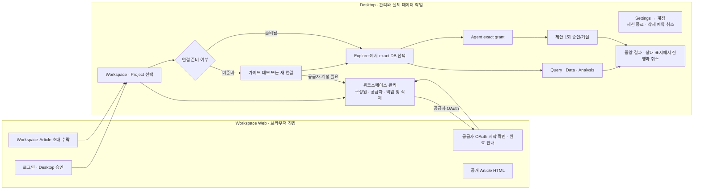

# 제품 UI 및 기능 범위 정본

이 문서는 DopeDB 화면 구조, 상호작용 원칙, 기능 범위 결정을 소유한다. 기준은
DopeDB의 제품 축, 실제 사용자 작업, 접근성, 운영 안전성, 지원 플랫폼의 동작이다.
제3자 제품의 화면, 기능 목록, 명칭, 코드, 자산은 정본이나 구현 근거가 아니다.

## 판단 순서

화면 또는 기능을 추가하기 전에 다음 순서로 판단한다.

1. workspace가 공유 접근과 구성원별 자격 증명을 더 안전하게 소유하게 하는가?
2. 연결의 첫 성공 경로를 더 짧고 명확하게 만드는가?
3. exact grant 안에서 일하는 Agent를 사람이 관찰·승인·중단·복구하는 데 필요한가?
4. SQL이나 Agent에게 한 문장으로 맡기는 편이 더 빠르지 않은가?
5. 실제 command와 authoritative state owner가 있는가?

`구현 안 함`, `범위 밖`, `미결` 항목은 label, icon, disabled placeholder를 제품
화면에 추가하지 않는다. 결정을 뒤집을 때는 이 문서를 먼저 고치고 화면을 고친다.

## UI 계약

### 전체 작업 흐름과 단일 소유권

한 작업은 아래 흐름에서 한 surface만 소유한다. 다른 surface는 현재 상태와 정확한
이동 link만 보여 주며 같은 command를 다시 만들지 않는다.

| 사용자 목적 | 유일한 command 소유자 | 다른 surface의 역할 |
| --- | --- | --- |
| workspace 생성 | Desktop workspace menu `새 워크스페이스` | 브라우저는 workspace를 만들지 않음 |
| 구성원 초대·역할·제거 | Desktop `워크스페이스 관리 → 구성원` | 브라우저는 이메일 초대 링크의 수락만 소유 |
| 팀 연결 생성(연결 정보·자격 증명 방식·환경) | Desktop connection editor(`새 연결`·데이터 소스 선택기) | 별도 공유 DB 추가·복사 경로는 없고, 저장이 secret-free workspace 연결과 만든 사람의 로컬 자격 증명 binding을 함께 만든다 |
| 구성원별 DB 권한(없음·읽기·쓰기) | Desktop `워크스페이스 관리 → 구성원` | 연결 편집기와 Explorer는 적용된 권한만 표시 |
| 연결 편집 충돌 검토(보존된 오프라인 편집) | Desktop 연결 편집기(해당 연결을 관리하는 구성원) | 별도 `DB 접근 권한` section은 없다 |
| provider 계정 승인·재승인·managed 연결 복구·Neon branch | Desktop `워크스페이스 관리 → 공급자` | 브라우저는 OAuth 시작 확인과 완료 안내만 소유하고 설정을 진행하지 않음. 연결 편집기·Explorer는 연결 상태와 이 화면의 exact 연결 복구 command만 제공하고, DB 등록은 연결 편집기가 소유하므로 이 화면에 DB 추가 경로를 두지 않음 |
| server backup·key rotation·retention·workspace 삭제 예약 | Desktop `워크스페이스 관리 → 백업 및 삭제`(Owner) | 삭제가 예약되면 취소는 `Settings → 계정`이 소유 |
| 삭제 예약 취소·다른 기기와 브라우저 session 종료 | Desktop `Settings → 계정` | 계정 전환·추가·로그아웃은 title toolbar 계정 메뉴가 소유하고, 같은 메뉴의 `계정 관리`가 이 section을 연다 |
| 자격 증명 방식(member-local·provider managed·구성원별 DopeDB 계정)·연결 profile·연결 검사 | Desktop connection editor | Web은 credential 입력·편집을 소유하지 않음 |
| Project binding·schema/object 탐색 | Desktop Explorer | Agent와 결과 문서는 별도 resource tree를 만들지 않음 |
| SQL·조회·Article 작업 | Desktop 중앙 document | 실행 결과·출력도 같은 중앙 작업 영역에서 확인 |
| Agent resource 선택·제안·승인 | Desktop Agent | 중앙 document는 Agent grant나 승인 control을 복제하지 않음 |
| Article 공유·이메일 지정 초대 | Desktop Article의 공유 dialog와 Workspace의 Article invitation application | 참여한 멤버와 DB grant의 변경·회수는 `구성원`·`DB 접근 권한`이 계속 소유 |
| 실행 결과·background 진행·취소 | 중앙 결과 문서 및 하단 상태 표시 | Agent는 요약과 결과 이동만 제공 |
| write 실행 상한 | Desktop `Settings → Safety` | 연결 편집기와 실행 오류는 상태와 이 화면의 link만 제공 |

화면 진입 뒤에는 `현재 맥락 → 지금 할 한 작업 → 결과/복구` 순서만 둔다. 선행
조건이 충족되지 않은 위험 command는 비활성 form으로 미리 노출하지 않고, 해결할
항목과 실제 목적지부터 보여 준다. 같은 위험 동작에 exact-name 입력과 별도 browser
confirm을 겹치지 않으며, 기본 성공 경로 밖의 옵션은 명시적인 고급 설정 disclosure로
접는다. 연결 편집기의 저장 동작은 `저장`(편집 유지)과 `저장하고 닫기`로 표시한다.
연결 검사는 변경 내용을 저장하지 않는다고 안내하고, Project에서 시작한 연결의 저장
완료는 exact Environment binding까지 성공한 뒤 Project 배정 완료로 안내한다.

### 화면 구조

- 로그인 전에도 Workspace 메뉴와 `새 워크스페이스`는 보인다. 생성 선택은 로그인
  필요 안내와 기존 Desktop 로그인 경로를 열며 인증 전에는 공유 상태를 만들지 않는다.
  검색 오른쪽의 `쿼리 이력`은 실제 실행 이력 문서를 직접 연다.
- Explorer는 연결에서 선택한 DB만 펼친다. 서버의 다른 DB 선택은 연결 편집기가
  소유하며 다른 DB를 같은 Project resource처럼 암묵적으로 노출하지 않는다.
- SQL 연결 행의 우클릭과 `⋯`는 같은 메뉴의 `새 쿼리 콘솔`을 연다. 생성은 기존
  SQL 문서 command를 재사용하며 현재 선택과 무관하게 해당 행의 정확한 연결·DB를
  대상으로 한다. 다른 연결에서 선택한 테이블·스키마를 가져오지 않고 MongoDB에는
  SQL 콘솔 항목을 표시하지 않는다.
- 개인 Workspace의 Analysis Article도 같은 HTML·정확한 쿼리·revision 계약으로
  로컬에 저장·편집·삭제·수동 재조회한다. 개인 문서는 기기 밖으로 전송하지 않으며
  팀 공유·공개 발행은 인증된 공유 Workspace에서만 제공한다.
- Settings는 기기 설정, AI 에이전트·계정, 워크스페이스·계정, 데이터 소스로
  관련 항목을 묶는다. `연결·환경`은 현재 연결의 편집기와 exact Project 환경 관리로
  이동한다. 환경은 `개발`·`스테이징`·`운영`·`테스트` 고정 목록에서 고른 값 하나이며
  그 값이 곧 환경 이름이다. Project 안에서 같은 종류의 환경은 하나만 둘 수 있고
  자유 입력 이름, 별도 위험 등급, `custom`은 없다. 연결의 유효 환경은 묶인
  Project 환경들과 연결 자체 표시 중 `운영 > 스테이징 > 테스트 > 개발` 순으로
  가장 민감한 값이다. 연결 자체 표시는 연결 편집기 General의 선택 사항 환경
  select(같은 4개 값)이며 Options에 중복하지 않는다.
  동일 연결이 복수 환경에 속하면 전체 환경 라벨을 함께 보여주고 특정 관리 경로를
  임의로 선택하지 않는다. BigQuery·팀 연결도 같은 General 환경 control을 쓴다.
  `운영` 확인(변경 작업의 PROD 확인), 운영 주의 표시, 저장 스냅샷 게시 차단 같은
  운영 안전 동작은 유효 환경에서만 파생하며 별도 flag를 두지 않는다. `운영`
  환경을 만들 때(새 Project의 첫 환경 포함)는 명시적 확인을 받는다. provider
  가져오기도 별도 `운영인가` 질문 대신 같은 환경 select를 묻는다.
  워크스페이스 관리의 변경 command는 기존 관리 dialog가 계속 소유한다.
- 새 데이터 소스 추가 화면은 왼쪽 패널에 검색 가능한 전체 연결 종류를 즉시 표시한다.
  저장된 연결 목록과 별도 자동 선택 팝업을 겹쳐 표시하지 않는다. 종류를 선택하면
  오른쪽에 해당 연결 설정을 표시하며 미선택 상태에서는 임의 엔진 폼을 열지 않는다.
  좁은 창에서도 같은 전체 카탈로그를 화면 안에 표시한다. 명시적 엔진 preset은
  해당 폼을 바로 열고, 기존 연결 편집의 탐색과 저장 동작은 유지한다.
- BigQuery는 연결 선택기의 별도 클라우드 데이터 웨어하우스 항목으로 진입한다.
  Agent 계정의 이름·플랜은 공식 CLI의 공개 상태 명령만 사용하고 설정과 채팅에
  표시한다. 계정 변경은 기존 공식 CLI 로그인 명령과 재확인으로 연결하며 토큰을
  읽거나 다른 앱의 계정 저장소를 가져오지 않는다.

- Desktop 설치 파일은 macOS Apple Silicon과 Windows x64만 제공한다. macOS Intel은
  새 stable·canary 설치 파일, updater platform, 다운로드 선택에서 제외하며
  이미 공개된 과거 릴리스는 수정하지 않는다.
- Desktop 언어는 신규 설치에서 `시스템 설정 (기본값)`을 사용한다. Settings → 언어에서
  시스템·한국어·영어를 즉시 선택하고 기기에 저장한다. 기존 명시적 선택은 유지하며,
  시스템 언어가 한국어면 한국어, 그 밖에는 영어를 표시한다. 시스템 모드는 WebView의
  언어 변경 알림과 앱 focus 복귀 시 현재 locale을 다시 읽고 재시작 후에도 유지한다.
- Desktop은 시스템 설정을 기본으로 따르며 Settings → 화면에서 시스템·라이트·다크를
  즉시 선택하고 기기에 저장한다. 시스템 모드는 OS 변경도 자동 반영한다. 기존 다크
  palette와 밝은 중립 palette가 같은 semantic role과 평평한 pane 배치를 공유한다.
  title toolbar는 검색 위아래 여백 없이 32px 높이와 32px action을 사용하고
  좁은 D를 기울어진 행성 고리가 감싸는 공용 브랜드 마크를 표시한다.
  헤더 왼쪽의 브랜드 오른쪽 패널 토글은 현재 Explorer·Local History를 닫고 같은 패널을 복원한다.
  Local History의 선행 뒤로 버튼과 상단 메뉴 재선택은 Explorer로 돌아간다.
  기록을 보는 동안 Explorer의 검색·펼침·스크롤 상태와 중앙 작업 문맥을 보존하며,
  좁은 창에서도 같은 drawer 안에서 복귀한다. 이는 SQL revision 비교·이동 기능이
  아니라 shell의 기본 복귀 경로다.
  AI Chat은 계정과 구분되는 네 꼭짓점 곡선 Astroid 아이콘을 사용한다.
  Desktop 다크 테마의 canvas·panel·선택은 푸른 기 없는 중립 차콜을 사용하고
  primary는 밝은 중립색으로 구분한다. DB 로고는 원본 컬러를 보존하며 상태색은
  성공·정보·경고·오류 의미에만 사용한다. Agent 메뉴의 설정은 Settings → Agent를
  열고 최초 설치 안내를 다시 열지 않는다.
  왼쪽은 Workspace 선택과 Databases / Articles 진입을 소유하고 AI Chat 진입은
  헤더 오른쪽 한 곳에 둔다. 탐색 메뉴와 도구·검색·트리는 같은 12px gutter를 공유한다. Article 읽기는 간결한 sans 제목, 한 줄 작성 정보, 핵심 지표와 차트를 단일 문서 열에 둔다.
  exact DB·revision·목차·저장 쿼리·최근 로컬 결과는 본문 아래 검수 disclosure에
  기본으로 접는다. 수동 재조회와 실행 중 취소는 제목 아래에 항상 접근 가능하게
  두며 검수 펼치기는 쿼리를 실행하지 않는다. 새 HTML은 사용 가능한 Agent 작성
  스킬을 활용해 핵심 지표와 발견 내용을 짧게 전달한다. DopeDB는 고정된 레이아웃이나
  지표·차트 개수를 지시하지 않고 허용 HTML과 Article 저장 계약을 안내한다.
  공유와 편집은 상단, 공개 발행·history·삭제는 더보기로 정리한다. 예시 작성자,
  pinned 상태, member count는 서버나 로컬 state가 실제 제공할 때만 표시한다.
- 상단은 브랜드와 검색·계정·설정, 실제 전역 command를 제공한다. Workspace 선택은
  Explorer 상단에 두고 Explorer를 숨기거나 Local History를 열면 title toolbar에
  표시한다. 각 작업 면은 해당 문맥과 document tab을 소유한다.
- 화면 이동은 클릭 즉시 선택 또는 진행 상태를 보여 주고, 새 화면의 지연 로딩이
  중앙 pane 전체를 빈 화면으로 바꾸지 않게 한다. 같은 연결의 문서 전환은 새
  화면이 준비될 때까지 기존 문서를 유지하고, 다른 연결로 바뀌면 이전 DB의
  내용을 보여 주지 않은 채 tab strip 높이를 유지한 국소 loading 상태를 쓴다.
  저장·조회가 끝나야 완료되는 command는 눌린 control에서 진행 상태를 표시한다.
- 왼쪽 Databases와 Articles는 서로 배타적인 탐색 범위를 소유한다. Databases에는
  `Project → Databases / Data sources`와 미배정 연결만, Articles에는 Project별
  Article collection만 표시한다. Databases 안에는 분석 folder나 Article을 표시하지 않는다.
  Project·Environment·binding identity는 두 진입에서 동일하게 유지한다. Explorer는 실제
  catalog를 소유한다. 상단 도구는 Project 추가·Environment 추가·새로고침·검색 네 개만
  두고, 닫기는 헤더의 패널 토글이 소유한다. 별도 닫기와 보기 옵션 메뉴는 두지 않는다.
  활성 아이콘은 hover 시 중립 배경과 선명한 glyph로 반응하며 비활성 아이콘은 반응하지 않는다.
  Environment는 exact grant와 binding을 소유하는 domain으로
  유지하되 Project 아래 시각적 folder로 반복하지 않는다. `Databases`는 Project의
  모든 환경 binding을 한 목록으로 투영하고 각 DB 행에만 exact Environment의
  dev/staging/prod marker를 표시한다. Data source와 Analysis Article 행은 같은
  Project folder에 모으되 선택 시 원래 Environment identity를 보존한다. 아직
  Environment에 묶이지 않은 연결은 `Unassigned`에만 표시한다. 그 행을 원하는
  Environment에 이미 묶인 DB 행으로 끌어 놓거나 Project의 `Databases` folder에
  놓으면 기존 environment-connection binding command로 이동한다. folder drop은
  그 Project에서 현재 선택된 Environment를 우선하고 없으면 첫 Environment를
  exact binding 대상으로 사용한다. Team Workspace의 로컬 연결을 놓으면 같은
  명시적 동작 안에서 비밀값 없는 shared connection identity를 먼저 발행하고 해당
  identity를 binding한다. 구성원 비밀번호와 BigQuery Google CLI 인증은 기기에
  남는다. BigQuery Google 계정은 exact Workspace·구성원 범위의 app-selected
  공식 CLI profile로 격리하고, 서비스 계정은 그 범위 안의 개별 connection
  binding에 더 좁게 묶는다. 어느 경우에도 이메일·token·key·credential 경로를
  shared record에 넣지 않는다. 발행 또는 binding 실패 시 새 shared identity를
  롤백해 중복 연결을 남기지 않는다. Environment가 없는 Project는 database binding
  화면을 사용하며, 이미 묶인 연결을 암묵적으로 재배치하거나 복제하지
  않는다. 한 workspace의 DB 연결은 동시에 한 Project Environment에만 배정되며,
  다른 Project로 옮기려면 DB 행의 명시적인 `프로젝트에서 제거` command로 기존
  binding을 먼저 해제한다. 이 command는 공유 연결이나 구성원 자격 증명을 삭제하지
  않는다. Project 행의 삭제 command도 connection 자체는 보존해 `Unassigned`로
  돌려보내고 source sync·Agent grant를 폐기하며 해당 Environment에 고정된 실행 중
  Agent session도 중단한다. active Analysis Article이 있는
  Project는 Article을 명시적으로 삭제하기 전에는 삭제할 수 없으며, 삭제된 Article의
  version history와 공개 HTML snapshot은 보존한다. Analysis collection의 문자·상태
  필터와 Article 선택도 Explorer가 소유하며, 중앙 Analysis document는 선택한
  Article만 표시하고 별도의 collection
  rail을 만들지 않는다.
  Project의 `Databases` 목록은 행 pointer drag, 행 메뉴, 또는
  `Option/Alt+위/아래 화살표`로 구성원별 표시 순서를 바꿀 수 있지만
  Project·Environment binding 자체는 변경하지 않는다. 같은 schema group은 하나의
  연속된 이동 블록으로 유지하며 블록 안에서는 production, staging, test,
  development 순서로 표시한다. pointer preview와 이동 완료 안내도 블록 전체를
  하나의 대상으로 표현한다.
- Project의 `Databases +`에서 시작한 PostgreSQL, MySQL, SQLite, MongoDB,
  BigQuery 연결은 저장 성공과 같은 흐름에서 그 Project의 현재 preferred exact
  Environment에 binding한다. 연결만 만들고 `Unassigned`에 남기는 중간 상태를
  성공으로 표시하지 않으며 binding 실패는 connection editor에서 복구 가능하게
  유지한다. 전역 `New connection`으로 만든 연결은 사용자가 Project를 정하지
  않았으므로 계속 `Unassigned`에 둔다.
- Project 삭제는 Project와 그 binding만 제거한다. 연결 identity·credential·DB
  권한은 보존하며, 다른 Project에 속하지 않은 연결은 `Unassigned`로 표시한다.
  Project가 하나도 없으면 같은 연결을 탐색기 최상위에 표시한다.
- 중앙 document surface는 welcome, query, data, schema, analysis처럼 현재 작업
  하나를 소유한다. MongoDB 연결은 BSON `find`/`aggregate`/`count`를 수행하는
  조회 surface를 유지하되 이를 범용 `문서` 작성 기능으로 표현하지 않는다.
  마지막 MongoDB 조회 tab을 닫아도 모호한 문서 생성 화면을 만들지 않고 새
  MongoDB 조회 surface를 즉시 유지하며, 조회 가능한 collection이 없으면
  `조회할 컬렉션이 없습니다`라는 정확한 빈 상태만 표시한다.
- 스키마 비교는 기준 DB·비교 대상을 한 번만 선택하고 변경 건수는 상태 필터에
  합친다. 관계별 경로를 한 번 표시하고 하위 객체 이름은 말줄임 없이 줄바꿈한다.
  기준·대상 값을 클릭 없이 나란히 보여 주고, 기준·대상 값은 색과 기호로
  구분한다. 전체 텍스트는 선택 가능하며 검색·펼치기·별도 안내 도구 행은 두지 않는다.
  두 값의 나란한 배치와 세로 배치는 viewport가 아니라 실제 workbench 폭을 따른다.
  스키마 조회·검증 화면이며 migration 작성이나 실행 command를 추가하지 않는다.
- CLI의 `schema diff`와 Project 고정 Agent의 `schema_diff`는 같은 읽기 전용
  비교를 제공한다. 두 DB를 명시하고 각 grant를 기존 Broker 경계에서 검증하며,
  비교 실패를 빈 스키마로 취급하거나 scope를 자동 확장하지 않는다. CLI 계약과
  실제 비교 속성은 [`contracts/cli-schema-diff.md`](contracts/cli-schema-diff.md)를 따른다.
- Personal Workspace의 첫 Welcome은 실제 파일 기반 SQLite, 로컬 Project와
  development Environment, 그 연결의 versioned binding을 한 번에 준비하는
  `가이드 데모` command 하나를 제공할 수 있다. 이 명령은 재실행해도 같은 데모
  자원을 재사용하고 team membership, 공유 credential, 권한을 꾸며내지 않는다.
  준비된 Welcome은 sample table 탐색, exact Environment에 고정된 Agent 읽기,
  `Settings → Safety`를 거치는 Agent 쓰기 승인의 실제 command 세 개만 flat
  목록으로 보여준다. 데모 연결이 있는 상태에서 다른 연결의 Welcome을 보면 같은
  `가이드 데모` command 하나가 데모 연결을 다시 선택하고 준비된 Welcome으로
  돌아가는 복귀 경로가 된다.
- 연결이 하나도 없는 시작 화면은 `이 컴퓨터에서 데이터베이스 찾기` command 하나를
  제공한다. 사용자가 실행했을 때만 PD-44의 닫힌 loopback allowlist를 자격 증명 없이
  한 번 확인하고, 응답한 서버를 engine·host·port가 채워진 새 연결 초안으로 여는
  command로 같은 평평한 목록에 덧붙인다. 감지된 서버가 없거나 확인에 실패하면 그
  사실만 문장으로 표시하고 `새 연결`과 `가이드 데모` command는 그대로 둔다.
- 시작 화면은 선택한 연결의 `welcome` 문서 탭 하나로만 열며 상단 Home command와
  Action Search로 다시 열 수 있다. 돌아갈 때 기존 쿼리 문서를 삭제하거나 연결을
  해제하지 않는다. 연결이 하나도 없으면 탭을 둘 연결이 없으므로 같은 시작 화면을
  workbench의 빈 상태로 표시한다. 마지막 연결을 삭제한 뒤에는 이 빈 상태로 돌아간다.
- 실행 기록(Activity) 문서의 진입점은 title toolbar의 기록 버튼 하나와 Action
  Search이며 이름은 `실행 기록`으로 통일한다. 읽지 않은 작업 표시는 그 버튼에
  붙는다. 상태 표시줄에는 별도 알림 버튼을 두지 않는다.
- 오른쪽 Agent surface는 한 Project의 명시적으로 선택된 resource set에 고정된
  대화, 도구 진행, 승인과 복구를 소유한다. context control은 Project 안의 DB,
  BigQuery, GitHub source revision을 같은 평평한 선택 surface에서 개별 또는 다중
  선택하게 하며 Project Environment를 별도 계층이나 이름으로 노출하지 않는다.
  DB 행의 dev/staging/prod marker는 실제 내부 binding을 설명하는 metadata로
  유지한다. 세션 시작 시 선택한 각 connection revision, source commit,
  Environment revision을 하나의 immutable exact grant로 고정하고 선택하지 않은
  Project resource는 접근할 수 없게 한다. 여러 DB의 읽기는 connection별 독립
  query로 실행해 대화에서만 결과를 종합하며 hosted proxy, 암묵적 cross-database
  join 또는 source 의미를 DB 값으로 추측하는 경로를 만들지 않는다. 쓰기는 선택된
  DB 중 최대 하나만 별도 `쓰기 대상`으로 지정할 수 있다. 이 지정은 권한 상승이
  아니라 Agent proposal의 상한이며 `Settings → Safety`, workspace grant, 실제 DB
  privilege와 사람의 exact approval을 모두 통과해야 한다. 닫힌 trigger는 Project
  이름과 선택한 DB/source 수, 쓰기 대상 유무를 계속 표시한다.
  채팅 열기와 `새 대화`는 입력 초안만 준비한다. 비어 있지 않은 첫 메시지를 전송할
  때만 선택한 exact grant의 ACP 세션을 만들고 대화 목록에 추가한다. 리소스와
  provider 선택만으로 ACP process나 빈 대화를 만들지 않는다. 이전에 공식 adapter가
  광고한 모델·승인 모드가 있으면 초안에서 선택하고 새 세션이 같은 선택지를 광고할
  때만 적용한다. 첫 prompt는 한 번만 전송하며 시작 중 수정한 다음 입력은 보존한다.
  입력창·포커스·레이아웃은 유지하고, 대화가 시작된 뒤에는 resource grant를
  변경하지 않는다. 대화가 시작된
  뒤 범위 메뉴는 고정된 선택과 새 채팅이 필요한 이유를 읽기 전용으로 보여준다.
  세션 시작은 Project binding을 다시 쓰지 않는다. 선택한 DB가 Project에
  추가된 뒤 revision이 바뀌었으면 입력 영역에 변경 내용과 `재확인`을 표시하고,
  사람이 재확인해야 새 revision으로 준비한다. Project에 속하지 않은 연결은 Agent가
  사용할 수 없다고 알리고 `프로젝트에 추가`로 잇는다. session이 닫히거나 회수·
  만료되면 그 session의 미결 DB 변경 제안은 `철회됨`이 되어 승인할 수 없다.
  답변 조각은 수신 후 다음 화면 frame에 반영하고, 생성 중 커서를 표시한다.
  최종 완료·권한 요청은 대기 중인 조각까지 즉시 반영하며 사용자가 위로 스크롤해
  읽는 중에는 강제로 아래로 이동하지 않는다.
  입력창 아래에는 exact resource 범위와 현재 승인 모드만 표시한다. provider와
  model은 제목 없는 32px 헤더의 하나의 선택 메뉴에 모으며, 좁은 패널에서도 입력과 범위가
  우선 보이게 한다. 승인 모드는 공식 ACP adapter가 광고한 선택지만 제공한다.
  사용자가 초안이나 세션에서 명시적으로 선택한 모드는 이 기기의 현재 workspace/account와
  provider에 한정해 기억하고, 새 세션에서 같은 선택지가 광고될 때만 적용한다.
  선택지가 없거나 적용에 실패하면 adapter의 현재 모드를 유지하고 실패를 표시한다.
  자동 승인은 adapter의 도구 권한 요청에 적용되며 exact resource grant,
  단일 write target과 DB 변경의 별도 승인을 대체하지 않는다.
  DB 변경 제안 카드는 포커스나 스크롤을 옮기지 않고 polite 알림으로 한 번 알린다.
  승인 버튼에는 자동 포커스를 두지 않는다. 패널이 닫혀 있으면 AI Chat 토글과 상태
  표시에 `승인 대기 N`을 표시하고, 상태 표시는 카드로 이동만 할 뿐 결정 control을
  복제하지 않는다. 승인된 실행은 카드와 상태 표시에서 실제 backend cancel로 중지한다.
- Personal DB-only 채팅은 계정 로그인 여부와 무관하게 로컬의 정확한 Project/DB
  revision 검증으로 시작하며, 선택하지 않은 GitHub Knowledge의 서버 준비 실패에
  종속되지 않는다. GitHub source를 선택한 세션과 Team 세션은 hosted authority
  재확인을 필수로 유지한다. 리소스 선택 목록은 권한 부여가 아니며 시작 시 실제
  선택한 리소스의 권한을 다시 검증한다.
- Agent 도구 설정은 Claude와 Codex를 각각 한 행으로 보여 준다.
  채팅의 `에이전트 계정 관리`는 `Settings → 에이전트·계정`을 열고 공식 CLI 상태를
  새로 확인한다. 계정·플랜과 공식 CLI 로그인 명령 복사·재확인은 기본으로
  보이고, 설치 상세만 접는다. 첫 실행 자동 준비 dialog는 저장된 Agent 선택이나
  나중에 선택이 없고, 설치 상태 확인 뒤 준비할 구성 요소가 있을 때만 연다.
  자동 표시 여부는 초기 조회가 끝난 뒤 한 번만 판단하며, 조회 오류나 CLI 검사
  실패는 미설치로 판단하지 않는다. 이후 설정 변경·재조회는 자동 dialog를 열지 않는다.
  선택한 Agent의 내장 채팅 연결 구성 요소는 앱이 검증해 설치·활성화하고, 공식 로컬 CLI의 설치·
  로컬 인증 설정 상태는 같은 행에서 확인한다. 계정 로그인과 공식 CLI가 관리하는
  조직 게이트웨이 인증을 모두 허용하며 설정 확인과 실제 연결 성공을 구분한다.
  CLI 상태 검사와 ACP 실행은 같은 선택 규칙을 사용한다. 상속된 절대 PATH를
  우선하고 GUI 실행에서는 사용자별 선택 설치 경로를 시스템 공통 경로보다 먼저
  확인한다. mise shim은 프로젝트 설정을 적용하지 않는 사용자 홈에서 실제 선택
  설치본으로 해석하고 그 CLI 파일을 실행 검증에 고정한다. 버전 숫자만으로 다른
  설치본이나 인증 설정을 자동 선택하지 않는다.
  상태 명령 실패는 미인증으로 단정하지 않는다. CLI가 없거나 인증 설정이 없으면 해당
  제공자의 공식 설정 안내로 이어간다. 앱은 CLI나 로그인 자격 증명을 대신
  설치·소유하지 않는다. 내장 채팅 선택 목록에는 명시적으로 선택했고 연결 구성
  요소와 CLI 설치·인증 설정이 모두 준비된 Agent만 표시한다. 준비되지 않은 행은
  설정에서 낮은 강조도로 보이되 준비·로그인 동작은 선명하게 유지한다.
  ACP·버전·릴리스 ID와 선택형 DopeDB 스킬은 행의 설치 상세에 두며,
  스킬은 내장 채팅 준비에 포함하지 않는다. 사용자 파일과
  충돌한 스킬을 자동으로 덮어쓰지 않는다.
- 외부 공식 Codex/Claude CLI는 `dopedb agent init`으로 Project root의
  `.dopedb/agent.json`을 만든다. 이 파일은 provider와 Project/resource UUID, 선택적인
  단일 쓰기 대상만 가지며 credential, URL, capability를 저장하지 않는다. 초기
  설정은 Desktop modal에서 한 Project의 DB·BigQuery·source를 고르고, 매
  `dopedb agent start`는 현재 이름과 revision으로 같은 exact set을 다시 보여준 뒤
  승인받는다. config에서 사라졌거나 권한이 바뀐 resource는 승인 control을
  비활성화한다. 이 modal은 범위를 넓히지 않으며 실행 중인 공식 CLI가 끝나면 해당
  process-bound session도 폐기한다.
  승인된 외부 Agent process의 DB 변경 제안은 같은 Desktop 승인 dialog에서 제안마다
  한 번 승인하거나 거절한다. 초기 포커스는 중립적인 닫기 동작에 두어 요청한
  terminal에서 입력하던 키가 승인 control에 닿지 않게 하고, 결정이 끝나기 전에는
  닫을 수 없다(제안 검토를 불러오지 못한 경우는 닫을 수 있다). process가 끝나 session이 폐기되면 미결 제안은 자동으로 취소된다.
- 전역 하단 Services 패널과 보조 보기는 제공하지 않는다. SQL 문서는 위쪽 편집기와
  아래쪽 결과를 같은 문서 안에 동시에 표시한다. 실행해도 편집기와 커서·선택·focus를
  유지해 바로 수정·재실행할 수 있으며 SQL/결과 교체 토글은 두지 않는다. 가로 경계선은
  드래그·키보드로 높이를 조절하고 더블클릭·Enter로 기본 1:1 비율에 복귀한다. 비율은
  기기 로컬 선호로 저장하되 좁은 높이에서 두 pane을 모두 읽을 수 있도록 제한한다.
  실행 중에도 editor와 controller를 유지한다. 중앙 실행 결과 문서는 같은 연결의 보존된
  결과·출력·다중 statement를 열고, 하단 상태 표시가 background 진행·취소를 소유한다.
- status surface는 현재 database/source/schema/object, transaction과 background
  상태를 보여주되 이미 document가 소유한 설명을 반복하지 않는다.
- Workspace 관리는 Desktop의 `워크스페이스 관리` dialog가 소유한다. 앱
  환경설정인 `Settings`와 분리된 shell modal이며 두 dialog는 서로를 대체할 뿐 겹쳐
  열리지 않는다. 팀 workspace의 관리자·소유자만 열 수 있고 `구성원`, `공급자`와
  소유자 전용 `백업 및 삭제` 세 section을 둔다. 권한이 없는
  구성원에게는 진입점과 section을 비활성 항목 없이 숨긴다. 진입점은 workspace
  menu의 `워크스페이스 관리`, Action Search와 관리형 연결 복구이다. 팀 workspace의
  모든 연결은 팀 연결이므로 `공유 DB 추가`라는 별도 진입점과 공유 데이터베이스
  목록은 없고, 연결 생성은 연결 편집기(PD-50)가 유일한 입구다. 로그인한 계정의 다른 기기·브라우저 session
  종료와 소유한 workspace의 삭제 예약 취소는 workspace가 아니라 사용자 단위이므로
  `Settings → 계정`이 소유하고, 계정 메뉴의 `계정 관리`가 그곳을 연다. 삭제가 예약되면
  Desktop은 membership을 다시 읽어 그 workspace에서 벗어나고 `계정`에서 영구 삭제
  시각과 취소를 보여 준다. 기록은 됐지만 정리 예약만 실패한 경우에는 같은 화면에서
  같은 요청을 다시 보낸다. workspace 생성은 workspace menu의 `새 워크스페이스`,
  관리 진입은 같은 menu의 `워크스페이스 관리`가 소유한다. 모든 관리 command는 Rust가 계정별 Bearer session으로 control plane의
  닫힌 작업 목록만 호출하며 session token, provider state, 입력한 provider secret을
  WebView 캐시나 로컬 저장소에 남기지 않는다. control plane이 구성원·권한·provider·
  lifecycle 결정의 정본이다.
  `공급자`는 공급자 계정 연결·재승인과 managed 연결 복구만 맡는다. 공급자 선택과
  선택한 공급자의 안내·입력을 보여 주고, 연결된 계정 관리는 같은 목록에서 연다.
  provider resource는 연결 편집기에서 DB를 고를 때 조회하며 이 화면에서 DB를 추가하지
  않는다. Google Cloud SQL 승인 뒤의 대상 선택·승인 흐름은 Desktop에서 이어서
  진행하고 진행 표시는 실제 구성 상태를 따른다.
- Workspace Web은 브라우저가 필요한 진입만 소유한다. 로그인과 Desktop 승인,
  workspace·Article 이메일 초대 수락, 공급자 OAuth의 시작 확인 페이지와 완료 안내,
  공개된 immutable Analysis HTML 페이지만 둔다. 공급자 OAuth 시작 페이지는 브라우저에
  로그인한 계정이 Desktop에서 승인을 시작한 계정과 같을 때만 공급자로 이동하고,
  다르면 계정 전환만 안내한다. 완료 안내는 token 없는 앱 복귀 link만 제공한다.
  예전 `/settings` 주소는 관리가 Desktop으로 옮겨졌다는 안내와 앱 열기만 보여 준다.
  연결 생성·편집, query, Agent, Safety, Analysis Article 작성·조회·수동 재실행·
  공개 발행 관리와 workspace 관리는 Desktop이 소유하며 Workspace Web에 중복 화면을
  만들지 않는다. 관리 API는 Desktop 배포와 독립적으로 운영되므로 지원 중인 Desktop
  버전이 쓰는 요청·응답 계약을 하위 호환으로 유지한다.

### 밀도와 상호작용

- 작업용 chrome은 낮고 조용하게 유지하며 정보는 실행 문맥 가까이에 둔다.
- command row와 tree row는 compact density를 사용하고, 선택·focus·위험·실패처럼
  의미가 있는 상태에만 색과 elevation을 사용한다.
- Desktop workspace 로그인은 native가 연 임시 localhost 주소에서 안내 화면 없이
  배포된 HTTPS 인증 경로로 즉시 이동한다. 웹 세션이 없으면 Google 로그인을
  자동 시작하고, 웹 세션이 있으면 계정 확인과 명시적인 승인을
  받고, native가 연 `127.0.0.1` 임시 포트의 일회성 callback으로 돌아온다.
  native는 짧은 만료의 state와 PKCE S256으로 authorization code를 교환하고
  계정별 OS 자격 증명 저장과 권한 전환을 마친 뒤에만 로그인 완료를 알린다.
  verifier, code와 session token은 WebView에 전달하지 않는다. 취소·만료·완료·앱
  종료 시 listener를 닫고, 이전 시도의 callback은 새 로그인에 영향을 주지 않는다.
  callback은 한국어·영어의 인증 전달·거절·오류 안내와 앱 복귀 동작을 제공하고,
  URL query를 지운다. 인증 전달 화면은 session 확인 성공을 미리 주장하지 않는다.
  실제 로그인 성공 뒤 native가 앱의 최소화를 해제하고 앞으로 가져온다.
  비밀값 없는 `DopeDB 앱 열기` URL은 앱 활성화만 소유하며 인증 완료 근거가 아니다.
  기존 RFC 8628 device endpoint는 호환 경계로 유지한다. 현재 `dopedb` CLI에는
  독립 Workspace 로그인 명령이 없으며 `agent start`는 실행 중인 Desktop의 승인과
  정확한 Project 권한을 사용한다.
- Action Search는 672px 이하의 non-modal surface다. 빈 질의는 scope와 input만
  보이고, Database·Documents·Actions·Settings처럼 실제 결과가 있는 범주만 둔다.
- popup, menu, modal은 viewport collision, keyboard 이동, focus containment와
  trigger 복구를 책임진다. 앱 내부 modal은 native 창처럼 보이는 drag header나
  `X`를 만들지 않고 footer의 명시적인 취소·닫기·완료 action으로 종료한다.
- data grid의 header/row는 28px, row number column은 최소 28px에서 가장 큰 행 번호의 자릿수에 맞춰 넓어지며, 기본 column은 144px을 기준으로 한다.
  virtualization 여부와 무관하게 selection, resize, sort, filter 계약은 같다.
  열 경계 더블클릭 또는 경계에 focus한 뒤 Enter는 해당 열만 현재 로드된 표시 값과
  헤더에 맞추며 자동 맞춤 상한은 480px이다. 추가 조회나 새 행 도착에 따른 자동 재조절은 하지 않고,
  수동 드래그는 기존 1200px 상한을 유지한다. 같은 열에서 다시 더블클릭 또는 Enter를
  실행하면 맞춤 직전 너비로 복원한다. 열별로 복원 상태를 보관하며 수동 너비 조절은
  해당 열의 복원 상태를 해제한다.
  열 경계 hover/focus 힌트는 `드래그: 너비 조절`과 `더블클릭: 자동 맞춤`을
  두 줄로 표시한다. 맞춤 상태에서는 둘째 줄을 `더블클릭: 이전 너비 복원`으로 바꾼다.
  조회 결과 영역 전체에서 트랙패드 확대·축소를 받아 해당 표의 글자·셀·열을
  50~200%로 함께 확대·축소한다. 일반 스크롤과 앱 chrome의 크기는 유지한다.
  기본 크기가 아닐 때 하단 결과 상태 표시 옆에 비율·복귀 버튼을 표시한다. 클릭 또는
  결과 영역 안의 ⌘0/Ctrl+0은 정확히 100%로 복귀한다.
  SQL 테이블의 scalar 기본키로 식별 가능한 행은 셀 더블클릭으로 값을 수정하고,
  수정 대기 값을 표시한다. 저장하기에서 정확한 UPDATE의 SET/WHERE를 검토한 뒤
  기존 proposal·승인·Safety 경계 안에서 원자적으로 저장한다. 기본키 수정,
  기본키 없는 결과와 decode 실패 행은 셀 편집을 제공하지 않는다. SQL 연결의
  기기 Safety 쓰기가 꺼져 있어도 로컬 수정안과 SQL 미리보기는 허용하되 저장은
  차단하고 설정 → 안전의 데이터 변경 설정을 안내한다.
- 테이블의 열 값 선택과 WHERE는 `DB 조회 조건`으로 표시한다. 열 메뉴의 값과 개수는
  불러온 페이지 기준이며 선택 시 DB를 다시 조회함을 메뉴 안에서 설명한다. SQL 결과의
  문자 필터는 `받은 결과에서 필터`로 표시하고 DB 재조회가 없음을 입력 옆에 안내한다.
  적용 중에는 받은 행 수 대비 실제 표시 행 수와 필터 해제를 결과 상태 표시에 유지한다.
- 사용자가 편집기에서 작성한 SQL은 Run 동작 자체를 exact payload 승인으로 사용해
  중복 검토 화면이나 확인 문구 입력 없이 실행한다. Agent와 background 작업이
  제안한 mutation은 사람이 작성한 것으로 간주하지 않고 별도 한 번의 명시적
  승인·거절을 유지한다.
- SQL 문서에서 직접 선택한 텍스트는 그대로 실행한다. 선택 없이 여러 statement를
  실행하면 caret 옆 메뉴에서 `현재 구문`과 `전체 스크립트`를 고른다. 메뉴의 hover와
  키보드 focus가 정확한 실행 범위를 미리 표시하고 Enter로 실행, Escape로 취소한다.
  미리보기는 실제 선택 영역이나 본문을 바꾸지 않으며, 편집으로 revision이 바뀌면
  후보를 폐기한다. 단일 statement는 메뉴 없이 실행한다. 범위 선택은 실행 권한을
  확대하지 않고 기존 parameter·exact payload 승인·Safety 경로를 그대로 사용한다.
- Desktop의 연결별 쓰기 실행 제어는 `Settings → Safety` 한 곳이 소유한다.
  연결 편집기와 작업 화면은 쓰기 권한을 변경하지 않으며, 상태 표시와 Safety
  진입만 제공한다. 관리형 연결의 `manage` 권한 보유자는 같은 Safety control로
  workspace 쓰기 상한과 현재 기기 gate를 함께 변경한다. 그 밖의 구성원에게
  workspace가 부여한 권한은 상한이고 기기별 Safety 설정은 이를 좁힐 수만 있다.
  이 화면은 `읽기 → 데이터 변경(DML) → 스키마 변경(DDL)`의 누적 권한을
  체크박스로 표시하고 한 번에 저장한다. 읽기는 항상 켜져 있으며 DDL은 DML을 먼저
  필요로 한다. DML을 끄면 DDL도 함께 꺼져 유효하지 않은 조합을 만들지 않는다.
  provider 설정·연결 편집기·실행 오류 화면에는 별도 권한 control을 만들지 않는다.
  동일 상태를 반복하는 별도 쓰기 허용 badge도 두지 않는다. 실행 오류는
  provider가 DDL을 지원하지 않는 경우에도 exact 연결의 이 화면으로 바로 이동해
  현재 사용 가능한 권한과 제한 이유를 확인할 수 있어야 한다. DDL은 workspace
  `manage` grant, 현재 기기의 명시적 DDL opt-in, 정확한
  Operation 승인과 provider가 검증한 짧은 스키마 자격 증명을 모두 만족할 때만
  가능하다. 기존 객체를 개인 단기 role 소유로 남기지 않고 provider adapter가
  안정적인 정책 owner로 인수·회수할 수 있는 연결에서만 DDL 단계를 활성화한다.
  이 계약을 충족하지 못하는 provider는 같은 Safety 화면에서 지원하지 않는 이유만
  표시하고 권한이 있는 것처럼 보이는 control이나 우회용 장기 owner secret을 만들지
  않는다.
- 새 팀 연결의 기본 접근은 analyst 이상 구성원 전체의 읽기이다. 별도 `팀 읽기`
  switch는 없으며 이후 구성원별 변경(없음·읽기·쓰기)은 `워크스페이스 관리 → 구성원`
  에서만 한다. Viewer는 목록 보기만 받으며, 쓰기·관리는 별도 명시 grant가 필요하다.
  쓰기 가능 여부는 구성원 권한과 쓰기 승인을 따르고 자격 증명 방식과 무관하다. 개별
  grant는 기본값보다 우선하며, 접근 회수는 탈퇴·재가입 뒤에도 유지한다. 기존 연결의
  접근은 이 변경으로 자동 확대하지 않는다.
- Workspace 관리형 연결의 Desktop 프로필은 실행 시 발급되는 실제 endpoint와
  credential을 편집 가능한 로컬 값처럼 표시하지 않는다. 연결 검사가 실패하면
  로컬 host·password 수정을 안내하지 않고 관리 주체, 관리자가 확인할 provider
  account·DB 등록·멤버 접근을 설명한다. exact `manage` 권한이 있으면
  `워크스페이스 관리 → 공급자`에서 해당 연결의 복구를 제안하는 실제 command를
  Explorer 연결 ⋮ 메뉴(`관리형 접근 복구`)와 오류 안내에 제공한다. 공급자 화면은
  설명에서 끝나지 않고 provider 재승인을 시작하는 복구 command를 소유한다. GCP Cloud SQL 복구는 기존 integration·project·instance를 고정한 채
  브라우저에서 OAuth를 다시 받고, Desktop에 돌아와 IAM DB 인증 flag와 전용 DB 사용자를
  재검증·복구한다. 기존 connection ID와 멤버 grant는 유지한다.
- GCP Cloud SQL 연결·복구 승인은 기존 애플리케이션 객체의 소유권 이전이나
  `PUBLIC` 접근 회수, 기존 사용자 승격/권한 정규화, 기본 권한 변경을 승인하지
  않는다. PostgreSQL 14 이상은 새 전용 데이터 계정 생성 시 predefined data role만
  부여하고 기존 계정은 변경 없이 검증한다. 과거 신뢰 정책의 principal은 보존하고
  정책 세대가 분리된 새 계정을 사용한다. 일반 연결·복구는 schema principal을
  자동 구성하지 않는다. 관리자가 별도로 DB와 기존 마이그레이션 owner 역할을
  지정한 스키마 설정은 새 전용 IAM 로그인에 그 역할만 위임한다. Desktop은
  승인된 owner로 실행하여 기존 객체 소유권과 새 객체의 기본 권한을 보존하며,
  모든 물리 접속에서 owner·멤버십·public 범위·권한 정책을 검증한다. 정책이 맞지
  않으면 기존 권한을 고치지 않고 구체적 진단으로 중단한다. 안전한 자동 구성이 없는 이전 PostgreSQL/MySQL은 변경 전에
  중단하고 member-local 연결을 안내한다. 상세 경계는
  [`GCP_SCHEMA_ACCESS_SAFETY.md`](GCP_SCHEMA_ACCESS_SAFETY.md)를 따른다.
- Neon 역시 연결 과정에서 PUBLIC·기본 권한·기존 객체 소유권을 바꾸지 않는다.
  스키마 접근은 별도 준비된 정책 owner가 있을 때만 제공하며, 복제 브랜치의 기존
  계정을 이름만으로 비활성화하지 않고 관리형 접근을 차단해 관리자 검토를 요청한다.
- enabled control은 반드시 실제 command와 state owner를 가진다. 아직 없는 기능은
  tracker에 `missing`으로 기록하고 가짜 control을 만들지 않는다.

- 직접 권한 변경 SQL과 안전하게 분류할 수 없는 SQL은 실행 전에 차단하고,
  구문 위치와 DB 관리자 검토 경로를 안내한다. 이 차단에 쓰기·DDL 설정이나 연결
  복구를 해결책으로 제시하지 않는다.
- Desktop에서 시작한 공급자 OAuth는 브라우저 완료 안내에서 token 없는 앱 복귀
  link만 제공한다. OAuth 승인만으로 완료를 선언하지 않으며 callback은 token·SQL·
  권한을 Desktop에 전달하지 않는다. Desktop은 창으로 돌아오거나 복귀 link를 받으면
  integration과 setup을 다시 조회하고 남은 단계를 이어서 진행한다. 연결 상태는 새로
  확인하되 SQL을 자동 재실행하지 않는다.

### 구현 시스템

- Tailwind v4의 정적 `tw:` utility와 `src/design-system/index.css`의 semantic role이
  화면 구현의 정본이다.
- 반복되는 시각·상호작용 계약은 공용 primitive로 승격하고
  `src/design-system/README.md`에 문서화한다.
- screen-level CSS, utility 문자열 객체, raw color, 동적 utility 조합은 금지한다.
- screenshot은 DopeDB 내부 회귀와 접근성 검수 증거로만 쓴다. screenshot 하나로
  기능 완료나 packaged runtime 동작을 주장하지 않는다.

## 기능 범위 결정

상태의 의미는 다음과 같다.

- `구현`: 현재 제품에 속한다. 상세 계약은 소유 domain과 ADR을 따른다.
- `구현 안 함`: 제품 축 대비 효용이 낮거나 Agent/SQL 경로가 더 직접적이다.
- `범위 밖`: 일반 IDE, 파일 시스템 또는 별도 플랫폼의 책임이다.
- `미결`: 제품 결정이 남아 있으며 구현을 시작하지 않는다.

| ID | 기능 | 결정 | 제품 계약 |
| --- | --- | --- | --- |
| PD-01 | Version Control | `범위 밖` | 일반 project VCS는 DB 접근 workspace의 책임이 아니다. |
| PD-02 | 자유 dock/move/detach | `구현 안 함` | left/right 고정 anchor와 resize를 유지한다. |
| PD-03 | project Local History | `범위 밖` | SQL document revision만 제품이 소유한다. |
| PD-04 | manual transaction | `구현` | query, table edit, Agent의 명시적 단일 write-target DB가 같은 물리 세션과 commit/rollback 경계를 공유한다. |
| PD-05 | structured Agent conversation | `구현` | 공식 ACP adapter와 로컬 CLI 로그인을 사용하고 앱은 provider token이나 login UI를 소유하지 않는다. |
| PD-06 | persistent multi-result | `구현` | bounded local snapshot과 capability-bound result artifact handle을 보존한다. |
| PD-07 | SQLite In-memory | `구현 안 함` | 비영속 연결은 공유·승인·감사 모델과 맞지 않는다. |
| PD-08 | 범용 cloud resource browser | `구현 안 함` | 연결 onboarding 중 검증된 target selector만 허용한다. |
| PD-09 | multi-database introspection | `구현` | Explorer, query, data editor와 Agent가 같은 정확한 database scope를 사용한다. |
| PD-10 | background task model | `구현` | SQL, 승인, ACP turn, import/export Job을 관찰하고 실제 backend cancel로 중단한다. |
| PD-11 | 전역 하단 Services 패널 및 보조 보기 | `구현 안 함` | 전역 하단 패널·실행 트리·토글은 두지 않는다. SQL 문서 내부의 편집기/결과 상하 분할과 높이 조절은 허용하며 결과와 출력은 중앙 SQL 문서 및 결과 문서가, 진행·취소는 기존 상태 표시가 소유한다. |
| PD-12 | result의 광범위한 IDE command set | `구현 안 함` | bounded inspect/copy/export를 유지하고 재조회는 SQL이나 Agent가 소유한다. |
| PD-13 | Local History compare/navigation | `구현 안 함` | SQL revision 선택·검색·복원만 제공한다. |
| PD-14 | inline AI editor assistance | `구현 안 함` | Project-resource-pinned Agent와 명시적 SQL context attachment가 소유한다. |
| PD-15 | project/files tool window | `범위 밖` | 일반 filesystem 탐색은 제품 밖이다. |
| PD-16 | 팀 연결 lifecycle(redacted 연결 revision) | `구현` | 팀 workspace의 모든 연결은 팀 연결이며 workspace가 secret-free 연결 revision과 grant를 공유한다. 자격 증명은 연결 편집기에서 고른 방식(member-local, 공급자 단기 managed lease, 구성원별 DopeDB 계정)에 따라 분리되고 장기 비밀값은 공유 레코드를 따라가지 않는다. 모델과 진입점은 PD-50이 소유한다. MVP의 provider import는 항상 새 managed connection을 만들며 기존 member-local connection을 ID 보존 방식으로 전환하는 migration UI/API는 두지 않는다. 직접 연결 방식(PD-49)은 secret-free endpoint와 공유 범위만 공유하며, 구성원 자격 증명은 구성원 기기가 만든 password verifier만 서버를 거쳐 관리자 기기로 전달된다. verifier는 평문 비밀번호가 아니고 서버는 평문, 관리자 자격 증명, 연결 URL을 저장하지 않는다. MongoDB 팀 연결은 `srv`, `authSource`, `replicaSet`만 닫힌 연결 옵션으로 공유하고 다른 driver parameter는 공유하지 않는다. Cloudflare D1 팀 연결은 account ID와 database ID만 공유하며 각 구성원이 자기 Wrangler 로그인으로 접근하고 workspace 쓰기 위임은 두지 않는다. `공유 DB 추가`, 별도 공유 데이터베이스 목록, `워크스페이스로 복사`, `내 연결 공유하기` 경로는 두지 않는다. |
| PD-17 | DDL file data source/mapping | `범위 밖` | 파일을 data source로 취급하지 않는다. |
| PD-18 | 검증된 DBMS/driver/credential broker 확장 | `구현` | 실제 수요가 있고 discovery·발급·TTL·회수·drift·E2E 경계를 닫은 adapter만 추가한다. 일반 PostgreSQL/MySQL은 서버 allowlist의 HashiCorp Vault Database Secrets AppRole로 구성원별 15분 이하 동적 자격증명을 발급할 수 있으며, 공용 static DB 비밀번호 배포는 금지한다. 공급자 API가 없는 직접 연결 PostgreSQL 14+/MySQL 8.0.21+는 PD-49의 구성원별 principal 방식만 허용하며 이 방식에도 schema lease와 DDL 자동 부여는 없다. 관리형 DDL은 stable provider-bound owner, 구성원별 단기 schema lease, exact `manage` grant, 객체 소유권 회수와 drift 검증을 모두 구현한 adapter에서만 `Settings → Safety`의 스키마 단계로 제공한다. Neon과 기존에 별도 검증된 GCP Cloud SQL PostgreSQL schema credential만 이 경계를 통과할 수 있다. GCP 일반 연결·복구는 기존 권한과 소유권을 보존하기 위해 data access만 구성하고 DDL 권한은 자동 확보하지 않는다. GCP PostgreSQL 관리자가 관리형 스키마 권한이 없는 연결을 볼 때 Safety의 스키마 행은 `관리자 연결 필요` 상태와 `관리자 연결 설정` 동작을 제공한다. 동작은 대상 주소·DB만 미리 채운 개인 로컬 연결 편집기를 열며 자격 증명·팀 권한·쓰기 동의는 복사하지 않는다. 안전한 자동 데이터 계정 구성은 PostgreSQL 14 이상으로 제한한다. Cloud SQL MySQL에는 schema lease를 발급하지 않는다. BigQuery는 수정하지 않은 공식 `bq`/`gcloud` CLI와 구성원별 인증만 사용하고 server dry-run·SELECT 제한·과금 바이트 상한·exact job 취소를 갖춘 read-only managed official-CLI driver로 한정한다. 시스템 SDK나 Python 설치를 탐색하지 않고, macOS arm64/x64 또는 Windows x64용 버전·크기·SHA-256 고정 공식 archive와 macOS Python installer 서명을 검증해 앱 전용 런타임을 최초 사용 때 원자적으로 준비한다. 사용자는 앱의 Google 로그인만 실행하며 별도 CLI 설치·명령 입력·버전 관리를 하지 않는다. 연결 onboarding은 project/dataset ID 직접 입력, exact Workspace·구성원 범위의 `gcloud auth login` 브라우저 인증, 서비스 계정 JSON 경로를 개별 member-local connection binding 범위의 `gcloud auth login --cred-file`에 일회성으로 넘기는 세 경로를 제공하며, 인증 뒤 `gcloud` project/`bq` dataset 결과를 실제 selector로 표시한다. 비밀값 없는 BigQuery identity는 Team Project에 공유할 수 있고 각 구성원은 자신의 Google 계정 또는 서비스 계정 credential을 로컬에서 선택한다. 앱은 Google OAuth client, token, refresh token, service-account key 내용이나 경로를 읽거나 저장하지 않는다. Cloudflare D1은 시스템에 설치된 수정하지 않은 공식 Wrangler 4 CLI만 사용한다. 연결 편집기의 한 번의 브라우저 OAuth 뒤 접근 가능한 account와 D1 database를 selector로 표시하며, 앱은 token을 읽거나 저장하지 않고 exact Workspace·구성원·connection 범위의 Wrangler home만 소유한다. 프로필에는 account/database 식별자만 저장하고 모든 provider traffic과 refresh는 Wrangler가 수행한다. 수동 조회와 기존 exact 승인·Safety gate를 통과한 쓰기·DDL은 지원하되, Wrangler OAuth가 별도 D1 read-only scope를 제공하지 않으므로 DB 강제 read-only가 필요한 Agent·Analysis Article 경로에는 이 adapter를 노출하지 않는다. workspace에는 account·database 식별자만 담은 팀 연결로 공유할 수 있고 Wrangler token과 Wrangler home은 공유하지 않으며 각 구성원의 Cloudflare 계정 접근은 팀이 Cloudflare에서 따로 부여한다. 임의 API origin, 수동 transaction, import script는 제공하지 않는다. |
| PD-19 | 고급 connection/session option | `구현` | direct TLS와 시스템 OpenSSH Host alias 하나만 제공하며 키와 passphrase는 OS가 소유한다. |
| PD-20 | Explorer object authoring | `구현 안 함` | DDL은 Agent가 작성하고 사람은 승인한다. |
| PD-21 | Settings staged apply/scope | `구현 안 함` | 즉시 또는 section별 저장을 유지한다. |
| PD-22 | data source comment/color | `구현 안 함` | 공유 연결 구분은 environment badge가 소유한다. |
| PD-23 | authentication/save policy 선택 | `구현 안 함` | engine마다 검증된 최소 입력 경로 하나를 유지한다. |
| PD-24 | status breadcrumb 탐색 | `구현` | 현재 문맥을 표시하고 Explorer의 정확한 문맥을 reveal한다. |
| PD-25 | 전역 manual transaction 상태 | `구현` | 장기 transaction을 발견하고 해당 연결에서 commit/rollback하도록 한다. 만료 5분 전에 경고하고, 열린 transaction이 있으면 창 닫기와 앱 종료 전에 롤백 확인을 받으며 어떤 종료 경로도 암묵적으로 commit하지 않는다. |
| PD-26 | data grid quick-filter/history | `구현 안 함` | 기존 column filter와 WHERE/ORDER BY, Agent 재조회 경로를 사용한다. 쿼리 결과 view에도 받은 행 substring quick-filter를 두지 않는다. |
| PD-27 | 범용 workspace settings bag | `구현 안 함` | 공유 상태는 connection과 Analysis Article 같은 실제 revision owner에 둔다. |
| PD-28 | safe branch checkpoint/restore | `구현` | 승인된 격리 생성, connection revision 전환, 복귀·폐기와 audit를 하나의 durable operation으로 묶는다. |
| PD-29 | engine별 native query cancellation | `구현 안 함` | exact operation signal, timeout, connection-close fallback과 unknown outcome 보존을 유지한다. |
| PD-30 | disk-backed query result | `구현` | Rust가 bounded page artifact와 streaming CSV/JSON export를 소유한다. |
| PD-31 | HTML Analysis Article | `구현` | sanitized HTML 본문과 exact connection에 고정된 읽기 전용 쿼리 하나만 저장하고 Desktop에서 수동 재조회한다. 본문은 공용 문서 스타일과 닫힌 allowlist의 정적 SVG 차트·도표를 지원하며, Agent는 내장 아티클 작성 스킬을 필요할 때 읽는다. 열린 아티클의 AI 수정은 그 아티클과 연결을 대상으로 한다. 저장한 최신 revision은 별도 draft/review/live 단계 없이 해당 connection grant를 가진 워크스페이스 멤버에게 공유된다. |
| PD-32 | enterprise shared-secret suite | `구현 안 함` | 중앙 static secret 배포·SSO·SCIM·self-hosted 묶음을 별도 수요 없이 예약하지 않는다. PD-18의 좁은 Vault Database Secrets 동적 발급 adapter는 이 suite에 포함되지 않는다. |
| PD-33 | general Plugin Platform | `구현 안 함` | app-owned driver, provider, ACP adapter의 닫힌 목록만 지원한다. |
| PD-34 | realtime SQL CRDT/presence | `구현 안 함` | 일반 SQL text와 cursor는 로컬에 두고 공유할 가치가 있는 결과만 HTML Analysis Article로 저장한다. |
| PD-35 | Arrow/Parquet plugin export | `구현 안 함` | bounded native CSV/JSON sink의 정확성과 취소 경계를 유지한다. |
| PD-36 | Project Knowledge graph | `구현` | source identity, immutable graph revision, evidence anchor, KnowledgeGrant와 승인된 mapping을 공유한다. |
| PD-37 | Project resource-set exact scope | `구현` | session 시작 시 한 Project에서 사용자가 선택한 connection/source/Environment revision 집합을 immutable pin으로 고정한다. 읽기는 선택 집합 안에서만 connection별로 실행하고 쓰기 proposal은 명시한 단일 DB에만 허용한다. |
| PD-38 | funnel analysis/block migration | `구현 안 함` | funnel·cohort·chart는 별도 UI domain으로 이관하지 않고 SQL 또는 Agent 결과를 일반 HTML로 설명한다. |
| PD-39 | metric signal monitoring | `구현 안 함` | Article은 수동 재조회 문서이며 cron·signal·background runner를 소유하지 않는다. |
| PD-40 | Analysis Article 삭제·공개 발행 | `구현` | optimistic revision 기반 삭제와 ADR 0007의 immutable public HTML 발행·해지를 제공한다. 별도 archive 상태 전환은 만들지 않는다. |
| PD-41 | External official Agent CLI | `구현` | `dopedb agent init/start`가 secret-free Project resource config, 매 실행 Desktop 검토, process-bound runtime-only typed bridge로 공식 로컬 Codex/Claude를 실행한다. 저장된 범용 MCP와 provider token 접근은 허용하지 않는다. |
| PD-42 | 조직 내부 Article 링크와 읽기 초대 | `구현` | 기존 구성원용 링크는 현재 계정의 Workspace membership와 해당 DB grant를 매번 확인한다. Workspace 관리자이면서 해당 DB의 manage 권한을 가진 사람만 이메일 하나에 고정된 48시간 초대 링크를 만든다. 검증된 수신 계정의 명시적 수락은 멤버 참여와 지정 DB의 read grant를 원자적으로 처리하며 기존의 더 높은 역할·grant는 보존한다. 링크 소지만으로 접근할 수 없고 회사 도메인을 조직 권한으로 추정하지 않는다. 앱 설치·로그인 안내 후 인증된 Desktop의 원래 Article로 연결하며 OS 설치 동의, member-local credential 입력과 Google CLI 인증을 대신하지 않는다. 브라우저는 초대와 앱 진입만 소유하고 Article query나 결과를 실행·제공하지 않는다. |
| PD-43 | 문서 탭 닫기와 재열기 | `구현` | 탭 닫기는 SQL document 삭제가 아니며 본문과 revision을 보존한다. 열린 SQL 탭 목록, 순서, 활성 SQL 탭은 workspace·account·connection 범위의 member-local 상태로만 영속하고 공유 레코드에 두지 않는다. 저장된 상태가 없으면 기존처럼 복원하고 저장된 빈 목록은 사용자가 모두 닫은 상태로 존중한다. 닫은 문서는 Action Search의 최소 재열기 command로 다시 연다. 별도 문서 관리 화면과 Local History 비교 UI는 만들지 않는다. |
| PD-44 | 로컬 데이터베이스 리스너 감지 | `구현` | 첫 연결의 입력을 줄이기 위해 사용자가 명시적으로 실행한 1회 감지만 수행한다. 대상은 loopback 주소와 engine별 기본 포트의 닫힌 allowlist(PostgreSQL 5432, MySQL/MariaDB 3306, MongoDB 27017)로 한정하고 임의 host, 포트 범위, 로컬 네트워크 대역, container runtime, 파일 시스템을 탐색하지 않는다. 각 후보는 자격 증명 없이 protocol handshake만 수행해 engine을, 프로토콜이 인증 전에 알려 주는 경우에만 서버 버전을 확인한 뒤 즉시 닫으며 인증 시도, startup 패킷, query를 보내지 않는다. `~/.pgpass`, `~/.my.cnf`, `pg_service.conf`, 환경 변수, 프로젝트 `.env` 같은 클라이언트 설정과 자격 증명 저장소는 읽지 않는다. 감지 결과는 engine, host, port, driver만 편집 가능한 초안에 채우는 제안이며 username, 비밀번호, database는 사람이 입력하거나 기존 database discovery가 채운다. 감지는 연결을 저장하거나 자동으로 접속하지 않고 백그라운드 polling과 주기적 재감지를 하지 않는다. 미설치와 감지 실패는 정확한 빈 상태로 표시하고 기존 수동 입력 경로를 막지 않는다. |
| PD-45 | 로컬 진단 로그와 버그 제보 | `구현` | Settings → 고급에서 명시적으로 켠 뒤 Desktop의 Rust 진단 이벤트, frontend 오류와 IPC 결과·시간을 bounded process-memory에만 수집한다. 기본은 꺼짐이며 끄기·종료 시 비우고 파일·서버에 전송하지 않는다. 인증 비밀값과 명시적 SQL·결과·Agent payload는 제외하되 호스트·DB 이름·사용자명·경로 같은 내부 정보는 포함될 수 있다. 조회·비우기와 개인정보 경고 확인 뒤 수동 복사·GitHub 이슈 작성 페이지 열기만 제공하며 자동 첨부·제출과 완전한 개인정보 자동 마스킹은 제공하지 않는다. |
| PD-46 | Desktop workspace 관리 | `구현` | workspace 생성, 구성원 초대·역할·제거·구성원별 DB 권한, 연결 편집 충돌, 공급자 계정 승인·재승인, managed 연결 복구와 Neon branch 관리, 소유자의 backup·key rotation·retention·삭제 예약, 계정 session 종료와 삭제 예약 취소를 Desktop이 소유한다. workspace 범위 관리는 앱 `Settings`와 분리된 `워크스페이스 관리` dialog가, 계정 session 종료와 삭제 예약 취소는 `Settings → 계정`이 맡는다. 팀 연결 생성은 이 dialog가 아니라 연결 편집기가 소유한다(PD-50). Rust가 계정별 Bearer session으로 control plane의 닫힌 작업 목록만 호출하고 경로 식별자를 검증하며 token·provider state·입력한 provider secret을 WebView 캐시나 로컬 저장소에 남기지 않는다. 브라우저 OAuth가 필요한 공급자는 control plane origin의 시작 확인 페이지만 열고 완료 뒤 Desktop에서 이어 간다. Workspace Web의 관리 화면은 제거하고 로그인·초대 수락·OAuth 시작 확인과 완료 안내·공개 Article만 남긴다. 구성원별 팀 연결 권한(없음·읽기·쓰기)은 `워크스페이스 관리 → 구성원` 행을 펼쳐 한 곳에서만 설정한다. `DB 접근 권한` section과 별도 팀 읽기 switch는 없고, 보존된 오프라인 편집의 충돌 검토와 구성원별 DopeDB 계정을 가진 연결의 삭제는 해당 연결의 편집기가 맡는다. 직접 연결 DB의 회수 대기 항목은 구성원 section에 유지한다. 권한이 없는 구성원에게는 관리 진입점과 section을 비활성 항목 없이 숨긴다. |
| PD-47 | Schema diagram 문서 | `구현` | 선택한 연결의 스키마 다이어그램(`schema` 문서)은 핵심 기능이 아닌 보조 surface다. 진입점은 연결 행의 ⋮ 메뉴와 Action Search의 `스키마 다이어그램` command뿐이며 title toolbar, 상태 표시줄, Welcome에는 launcher를 두지 않는다. 읽기 전용 조회 화면이고 DDL 작성·실행 command를 추가하지 않는다. |
| PD-48 | Desktop·호스팅 워크스페이스 사용 분석(제품 analytics·세션 녹화) | `구현 안 함` | DopeDB는 오픈소스이며 Desktop 앱과 호스팅 워크스페이스(app.dopedb.dev)에서 사용 이벤트, 퍼널, 세션 녹화, 동의 UI를 수집하거나 두지 않는다. 장애 대응용 정제된 오류 진단(Sentry)만 남기며 제품 퍼널 측정에 쓰지 않는다. 공개 소개 사이트(dopedb.dev)의 페이지 조회·다운로드 수 같은 식별자 없는 기본 집계만 유지하며 경계는 `docs/PRODUCT_ANALYTICS.md`가 소유한다. |
| PD-49 | 직접 연결 자격 증명 방식(구성원별 principal) | `구현` | 공급자 API가 없는 공개 접근 가능 PostgreSQL 14+ / MySQL 8.0.21+ 서버를 workspace 관리자가 연결 편집기에서 자격 증명 방식 `구성원별 DopeDB 계정`을 골라 등록한다(별도 공유 DB 추가 흐름은 없다). 서버에는 host·port·DB·TLS 모드와 공유 범위(PostgreSQL schema / MySQL database)만 저장하고 관리자 DB 자격 증명은 그 관리자 기기의 OS credential store에만 둔다. 등록 전 관리자 Desktop이 연결, 서버 버전, principal 생성 권한(PostgreSQL `CREATEROLE` 또는 superuser, MySQL `CREATE USER`와 `GRANT OPTION`), grantor 권한을 읽기 전용으로 검사하고 생성될 항목의 정확한 계획을 보여 준다. 각 구성원 Desktop은 강한 임의 비밀번호를 로컬에서 만들어 자기 OS credential store에 두고 PostgreSQL SCRAM-SHA-256 verifier 또는 MySQL `caching_sha2_password` 인증 문자열만 올리며 평문은 기기 밖으로 나가지 않는다. 관리자 자격 증명을 가진 관리자 기기가 서버가 만든 비추측 이름의 DopeDB 전용 principal을 만들고, 기존 권한 모델(역할·연결별 권한·팀 연결 기본 읽기·쓰기 허용)이 계산한 실효 접근을 그대로 반영한다: 없음·보기는 principal 없음, 읽기는 공유 범위의 CONNECT·USAGE·SELECT, 쓰기와 관리는 INSERT·UPDATE·DELETE까지이며 DDL은 부여하지 않는다. principal은 만료 없이 유지되고 구성원 제거·강퇴, 권한 하향·제거, 팀 연결 삭제 때만 회수한다. 관리자가 이 동작을 하면 그 관리자 기기가 서버 상태를 확정하기 전에 control plane receipt, DB 쪽 marker(PostgreSQL `COMMENT ON ROLE`, MySQL user `ATTRIBUTE`), role oid 또는 server uuid가 모두 일치하는 principal에만 REVOKE·DROP을 동기 적용하고 성공 뒤에만 완료를 보고한다. 관리자 계정이 세션을 종료할 수 있을 때(PostgreSQL superuser 또는 `pg_signal_backend`, MySQL `PROCESS`와 `CONNECTION_ADMIN`/`SUPER`)는 해당 principal의 열린 세션도 종료하고, 그렇지 않으면 접근을 회수하고 새 로그인을 막으며(기존 role membership은 바꾸지 않는다) 이미 열린 세션이 연결을 끊을 때까지 남을 수 있음을 결과로 알리고 추가 화면이 미리 경고한다. 쓰기→읽기 같은 하향은 DB 계정을 삭제하지 않고 목표 수준으로만 낮춘다. 그 기기에 해당 DB의 관리자 자격 증명이 없으면 즉시 회수가 불가능함을 경고하고 자격 증명 입력이나 보유 기기에서의 적용을 고르게 하며, 그동안 서버 권한은 유지한 채 `회수 대기`로 표시한다. 구성원 자가 탈퇴와 계정 삭제는 다음 관리자 기기 동기화에서 처리한다. 기존 사용자, role membership, 비밀번호, 권한, DEFAULT PRIVILEGES, PUBLIC ACL, 객체 소유권은 바꾸지 않고 principal이 객체를 소유하거나 소유권 증명이 하나라도 어긋나면 구체 진단과 함께 멈춘다. PostgreSQL은 기존 role의 기본 권한을 바꾸지 않으므로 공유 범위에 새로 생긴 테이블은 관리자 기기의 다음 동기화 뒤에 보인다. MariaDB, 다른 엔진, 공용 static 비밀번호, 자동 DDL 권한은 범위 밖이다. |
| PD-50 | 팀 연결 모델 | `구현` | 팀 workspace의 모든 연결은 팀 연결이며 별도 `공유 DB`, 공유 데이터베이스 목록, `워크스페이스로 복사`, `팀 읽기` switch, `공유 DB 추가`는 없다. 입구는 연결 편집기(`새 연결`·데이터 소스 선택기) 하나이고 저장이 secret-free workspace 연결과 만든 사람의 로컬 자격 증명 binding을 함께 만든다. editor 이상 역할이 팀 연결을 만들고 Project 환경에 배치할 수 있다(환경 binding 서버 규칙도 editor 이상이다). 새 팀 연결의 기본 접근은 analyst 이상 팀 전체 읽기이고 이후 구성원별 변경은 `워크스페이스 관리 → 구성원`에서만 한다. 자격 증명 방식은 새 연결의 편집기에서 고르는 속성이며 각 구성원이 자기 계정을 쓰는 기본 방식, 공급자 계정(`공급자`에서 연결)의 단기 managed 자격 증명(관리자), PD-49의 구성원별 DopeDB 계정 자동 생성(관리자) 중 하나다. 뒤의 두 방식은 편집기 안에서 기존 단계 흐름으로 진행하며 공급자 계정이 없으면 `공급자`로 안내한다. 승격·거절·도달 불가 결과와 기기 전용 SQLite 표시는 Explorer가 보여 준다. 쓰기 가능 여부는 구성원 권한과 쓰기 승인을 따르며 자격 증명 방식과 무관하다(member-local 팀 연결도 읽기 전용으로 강제하지 않는다). `공급자`는 공급자 계정 연결·재승인과 managed 연결 복구만 맡는다. 업데이트 시 팀 workspace의 기존 팀 로컬(`나만`) 연결은 자동으로 팀 연결로 승격한다. SQLite 파일 연결은 기기 전용이라 승격 대상이 아니며 UI는 SQLite 파일은 공유할 수 없다고 알린다. 개인 workspace는 변하지 않는다. 장기 비밀값은 공유 레코드를 따라가지 않고 기존 DB principal은 바꾸지 않는다. 결정 근거는 [ADR 0011](adr/0011-team-connections-and-environments.md)이다. |
| PD-51 | 환경 고정 목록과 유효 환경 | `구현` | 환경은 `개발`·`스테이징`·`운영`·`테스트` 고정 목록에서 고른 값 하나이고 그 값이 환경 이름이다. Project당 종류별 환경은 하나이며 자유 입력 이름, 별도 위험 등급(riskClass), `custom`은 없다. 기존 환경은 가장 가까운 종류로 이전한다(자유 이름은 현재 위험 등급에 따라, custom은 개발). 연결의 유효 환경은 가장 민감한 값(`운영 > 스테이징 > 테스트 > 개발`)이며 묶인 환경들과 연결 자체 표시 중에서 고른다. 연결 자체 표시는 연결 편집기의 선택 사항 환경 select(같은 4개 값)다. 변경 작업의 PROD 확인, 운영 주의 표시, 저장 스냅샷 게시 차단은 유효 환경에서만 파생한다. `운영` 환경 생성은(새 Project의 첫 환경 포함) 명시적 확인을 받고, provider 가져오기는 별도 `운영인가` 질문 대신 같은 환경 select를 묻는다. 이전 Desktop을 위해 control plane은 전환 기간 동안 기존 환경 필드(riskClass)를 종류로 매핑해 받고 돌려준다. 결정 근거는 [ADR 0011](adr/0011-team-connections-and-environments.md)이다. |

## 변경 규칙

기능 결정을 바꾸는 변경은 다음을 함께 갱신한다.

1. 이 문서의 해당 `PD-*` 행과 제품 이유
2. [`UI_IMPLEMENTATION_TRACKER.md`](./UI_IMPLEMENTATION_TRACKER.md)의 상태와 소유자
3. 실제 command/state owner와 관련 architecture guard
4. 보안·wire contract·핵심 여정이면 기존 critical test 본문의 assertion

과거 비교 자료나 외부 제품 기능 목록은 결정 근거로 저장하지 않는다. 필요한
근거는 재현 가능한 DopeDB scenario, 접근성 결과, 성능 수치, ADR과 코드 계약으로
남긴다.
